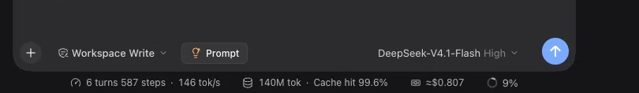
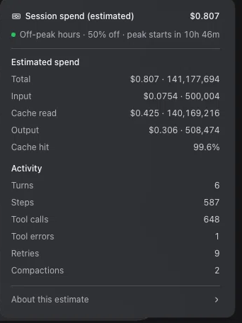

# Session spend 

[](https://github.com/Broklam/dsh-spend-tracker/actions/workflows/ci.yml)
[](LICENSE)
[](https://dsh-plugin.org/plugins/broklam/dsh-spend-tracker)

Adds an estimated spend reading to the DeepSeek Harness composer, priced at DeepSeek's published peak or off-peak rate, with a breakdown of where the open chat's money went.

Session spend is a [DeepSeek Harness](https://github.com/deepseek-ai/deepseek-harness) plugin. It adds one estimated spend reading to the composer statistics row under the input box, beside the built-in turns/steps and token readings. Click the reading for a breakdown by token bucket, cache hit, activity count, model, and subagent.

When the chat works with **agent teamwork**, the reading counts the whole team: every local subagent conversation the chat spawned — direct or nested — adds its own provider-reported spend to the estimate, and each member's share is listed in the panel. The team total updates as members settle, without waiting for the lead's next turn.



The estimate follows DeepSeek's published prices: each request is priced at the peak or off-peak rate for the time its usage settled, the panel names the rate that applies right now, and the price table refreshes itself from DeepSeek's published pricing page.

> **Hub category** Models & Reasoning · **License** MIT · **Profiles** web and desktop · **DSH** `>=0.2.2-rc.1 <0.3.0` · **Network** one background HTTPS GET for the public pricing page; no account, telemetry, or session content leaves the machine.

## What it shows

A single reading: `≈$0.67`. The `≈` marks an estimate. A session with no provider-reported usage shows nothing; a session on a model with no configured price shows its token count instead, so an unknown price never reads as zero spend.

Clicking the reading opens a panel with:

| Section | Rows |
| --- | --- |
| Rate status | Peak or off-peak right now, the off-peak discount when it applies, and when the rate next changes; hidden when `offPeak: false` |
| Estimated spend | This session and Subagents when a team exists, then the combined Total, input, cache read, cache write, output, reasoning, cache hit |
| Activity | Turns, steps, tool calls, tool errors, retries, compactions; counts this session only |
| By model | Spend and tokens per model, when more than one was billed across the session and its team |
| By subagent | Spend and tokens per subagent conversation, when the chat has a team |

Warnings stay visible at the bottom of the panel: unpriced usage, a truncated model list, or a truncated subagent list. Everything else — that the figure is an estimate rather than a bill, how much off-peak rates saved, and how fresh the price table is — sits behind a collapsed **About this estimate** row, so it stays out of the way until you open it.

A row appears when it has data; turns, steps, and tool calls are always shown. A chat without subagents keeps the single Total row it always had. Escape, a click outside, or activating another stats control closes the panel. The panel is measured once when it opens and stays put while values update, so a busy session cannot move it; long content scrolls inside it, with the title and rate status kept above the scroll area.



## Install

Requirements: DeepSeek Harness 0.2.2-rc.1 up to, but not including, 0.3.0, with the web UI. The package is published to npm as `dsh-spend-tracker`, ships plain JavaScript, and needs no build step or install-build permission. It installs in one step:

```sh
dsh plugin --profile web add dsh-spend-tracker
```

`web` is the profile `dsh web` runs. The Desktop app runs the `desktop` profile:

```sh
dsh plugin --profile desktop add dsh-spend-tracker
```

In the Desktop app you can also open **Plugins → Add plugin**, paste the package name, and turn the **Session spend** row on.

### Install from this repository

```sh
# web profile, from GitHub
dsh plugin --profile web add github:Broklam/dsh-spend-tracker

# web profile, from a local clone
dsh plugin --profile web add ./dsh-spend-tracker

# Desktop profile variants
dsh plugin --profile desktop add github:Broklam/dsh-spend-tracker
dsh plugin --profile desktop add ./dsh-spend-tracker
```

After installing, open a chat with at least one completed model call; the reading appears after the first settled response. Disable the row to remove the reading and stop the statistics. No account or API key is required, and no runtime dependency is installed.

## Configure prices

Spend is computed from token counts and a price table in units of your currency per million tokens. The bundled table holds the official [DeepSeek rates](https://api-docs.deepseek.com/quick_start/pricing) for the two models the DeepSeek providers ship in their built-in catalog. Peak and off-peak are the published values; off-peak is half of peak:

| Model | Tier | Input (cache miss) | Cache read | Cache write | Output |
| --- | --- | --- | --- | --- | --- |
| `deepseek-flash` | Peak | 0.30 | 0.006 | 0.30 | 1.20 |
| `deepseek-flash` | Off-peak | 0.15 | 0.003 | 0.15 | 0.60 |
| `deepseek-v4-pro` | Peak | 1.32 | 0.044 | 1.32 | 3.96 |
| `deepseek-v4-pro` | Off-peak | 0.66 | 0.022 | 0.66 | 1.98 |

DeepSeek publishes three rates: cache-hit input, cache-miss input, and output. The cache-write column repeats the cache-miss rate because that is what a written prefix is billed at; DeepSeek's usage records report no separate cache-write tokens. The bundled rates are DeepSeek's US-dollar prices; `currencySymbol` and `decimals` change only how amounts are displayed. To bill in another currency, replace the table.

Override or extend the table in your profile's `cordis.patch.yml`:

```yaml
- id: spend-tracker
  name: dsh-spend-tracker
  config:
    currencySymbol: '$'
    decimals: 4
    pricing:
      # A new route needs all four rates: no other model's numbers are borrowed.
      openai/gpt-5:
        input: 1.25
        cacheRead: 0.125
        cacheWrite: 1.25
        output: 10
      # A shipped model may set only the rates you want to change.
      deepseek-flash:
        output: 1.30
    # Prices every route no `pricing` key matches. Must be complete; omit the
    # key, or set it to null, to leave unmatched models unpriced.
    defaultPricing:
      input: 1
      cacheRead: 0.1
      cacheWrite: 1
      output: 4
```

Keys match as `provider/model` first, then as a bare model id, so one `deepseek-flash` entry covers every provider that serves it. A field you set overrides the live table; a field you leave out follows it, including refreshed prices. Another route inherits from `defaultPricing` when it is set and must supply all four rates otherwise. An entry without the rates it needs is ignored with a warning in the host log; a route with no bundled rates stays unpriced, while a shipped model keeps its bundled rates. The off-peak rate always follows the peak rate you set, at the published discount.

### Peak and off-peak hours

[DeepSeek's billing page](https://api-docs.deepseek.com/quick_start/pricing) defines peak hours as **01:00–04:00 and 06:00–10:00 UTC, Monday through Friday, excluding Chinese public holidays**. Every other hour is off-peak at half the peak rate, including weekends and Chinese public holidays in full.

The plugin classifies each usage settlement by its own UTC timestamp, so a session that spans a boundary pays the right rate on each side of it. The panel's status line reads the current clock, not the last model response, so it keeps ticking while you read it.

Weekday Chinese public holidays for 2026 and 2027 are bundled. `offPeak.holidays` replaces that list, so supply every date you need, including years already bundled.

```yaml
- id: spend-tracker
  name: dsh-spend-tracker
  config:
    # fraction taken off the peak rate: 0.5 means half price.
    offPeak:
      discount: 0.5
      windows:
        - days: [1, 2, 3, 4, 5]   # 0 = Sunday … 6 = Saturday, UTC
          start: '01:00'
          end: '04:00'
        - days: [1, 2, 3, 4, 5]
          start: '06:00'
          end: '10:00'
      holidays: ['2028-01-03']    # replaces the bundled Chinese list
```

`offPeak: false` turns time-of-day pricing off and bills everything at the peak table. Any `offPeak` block you write also stops the refresh from replacing the schedule, because the schedule is then yours.

### Keep prices current

The Host fetches the public pricing document through DeepSeek Harness's web capability, or through the process's own HTTP client when no web provider is available. The fetch runs once when the plugin loads and then every `refreshHours` (6 by default). It replaces the bundled prices for every model the page still lists with a complete peak and off-peak price; a model the page no longer lists keeps its bundled price. That same fetch also takes the page's footnote as the peak windows and discount unless you configured `offPeak` yourself.

```yaml
- id: spend-tracker
  name: dsh-spend-tracker
  config:
    pricingSource: deepseek   # 'off' stops the fetch and keeps local prices
    refreshHours: 6           # integer 1-168
    pricingUrl: https://api-docs.deepseek.com/quick_start/pricing.md   # https only
```

An invalid option is reported in the host log and replaced by its default. The request carries fixed headers (a `dsh-spend-tracker` user agent and an `Accept` header) and nothing else. If the fetch fails or the page is unreadable, the current table stays in place, the failure is written once to the host log, and the refresh is retried after 15 minutes (up to three times) before it settles back into its normal period.

Refreshed prices apply when a session's value is next recomputed — normally its next activity, or when it is reopened. An idle open session keeps its last reading until then.

## How the estimate is computed

- Usage comes from the provider's own accounting on each settled assistant message. A retried attempt stays billable: the attempt that streamed before the retry keeps its tokens, and the retried settlement adds, which matches the built-in token counter. Compaction summaries count as their own calls.
- Spend is `tokens × price ÷ 1,000,000` for each of input, cache read, cache write, and output, summed over the models the session used. The price is the peak or off-peak rate for that usage settlement's UTC time.
- Reasoning tokens are reported separately and **not** charged: providers bill them inside output tokens.
- A fork inherits its parent's spend prefix, the same way the built-in token counter does. A forked subagent therefore contributes its inherited prefix to the team total as part of its own conversation, exactly as the built-in child token reading shows it.
- Subagent conversations count once each. The panel finds them through the same `subagentCatalog` projection the Subagents menu uses, including nested children, and skips external tasks that have no local conversation. A finished subagent whose projections are not loaded (after a page reload, for example) is read from the Host once when the chat opens.
- The rate table is never folded into state, so a refreshed or edited price reprices the whole session the next time its value is read.

This is an estimate, not an invoice. The provider also bills some calls whose usage never lands in the session log — session-title generation and the web-search provider's own model turn — and the estimate cannot see those. Search and fetch API fees, file parsing, speech, subscription plans, bonus credit, and currency conversion are not modelled at all.

## Privacy

The plugin reads the configured pricing page (DeepSeek's by default) over HTTPS — once when it loads and then every `refreshHours` — with fixed request headers and no session content, credential, or identifier. It has no account, telemetry, or update channel. Everything else stays local: it folds usage that is already in the session log you control, and the result lives in memory and in the local projection cache. Set `pricingSource: 'off'` to make it fully offline.

## Compatibility

| Item | Detail |
| --- | --- |
| DeepSeek Harness | `>=0.2.2-rc.1 <0.3.0` (declared in `engines.dsh`) |
| Profiles | Desktop and web |
| UI surfaces | Composer dock entry `spend` in `conversation.composer.dock` |
| Dependencies | None at runtime; React and React DOM come from the app. The team total uses the Session controller's projection reads and falls back to the live cuts already in the page when they are absent |
| Permissions | Outbound HTTPS GET to the configured pricing URL (default `api-docs.deepseek.com`); no tools, no shell, no files outside the profile |
| Disable | Turn the row off; the reading disappears and the statistics stop |

## How it works

```text
session events ─────────► sessionSpend projection (Host) ──► wire view ──┐
subagent session events ► their sessionSpend wire views ────────────────┼──► composer dock reading + panel (Browser)
DeepSeek pricing page ──► price refresh (index.js + pricing.js) ────────┘   (reprices every wire view)
```

- [`index.js`](index.js) registers the `sessionSpend` session projection and the background price refresh.
- [`projection.js`](projection.js) is the pure fold: usage events in, per-tier token, call, and activity totals out; spend is derived when the value is rendered.
- [`pricing.js`](pricing.js) holds DeepSeek's peak windows, the bundled holiday calendar, and the parser for the published pricing markdown.
- [`client.js`](client.js) registers the reading and its panel, with the live rate-status line, the team total over the chat's subagent projections, and English and Simplified Chinese copy.
- Projection state is checkpointed and versioned, validated on restore, and excluded from session summaries, so the sidebar list carries nothing extra.

## Development

```sh
node --check index.js && node --check projection.js && node --check pricing.js && node --check client.js
node --test test/*.test.mjs
```

The tests cover peak and off-peak classification (including weekends, holidays, and window boundaries), the pricing-page parser and its fallbacks, retry bills, per-tier replacement, per-model attribution, unpriced models, compaction calls, activity counters, live repricing, the refresh registration and its fallbacks, the browser placement and status helpers, subagent team discovery and the combined team view (including nested members, external tasks, model merging, and the row cap), state validation, the wire contract, and that the English and Chinese copy tables stay in sync. They run against a fixture of the pricing page fetched on 2026-11-16, so a layout change on DeepSeek's side shows up as a parser warning instead of a silently mispriced table. There are no runtime dependencies to install.

## Marketplaces

- **DSH Discover tab**: this repository publishes a format-1 plugin index at `https://broklam.github.io/dsh-spend-tracker/index.json`. Open **Plugins**, switch on **Custom plugin indexes** under **Experimental plugins**, then choose **Discover → Add index source** and paste that URL. The index lives in [`marketplace/index.json`](marketplace/index.json) and pins each listed release to its commit.
- **DSH Plugin Hub** ([dsh-plugin.org](https://dsh-plugin.org)): listed as **Models & Reasoning** at [dsh-plugin.org/plugins/broklam/dsh-spend-tracker](https://dsh-plugin.org/plugins/broklam/dsh-spend-tracker). The community directory indexes public repositories tagged `dsh-plugin`; install the published package by name from **Plugins → Add plugin**, or add this index source under Discover.

[docs/PUBLISHING.md](docs/PUBLISHING.md) covers both submission paths step by step, including the npm release that makes the package available from the Plugins page.

## License

[MIT](LICENSE)
